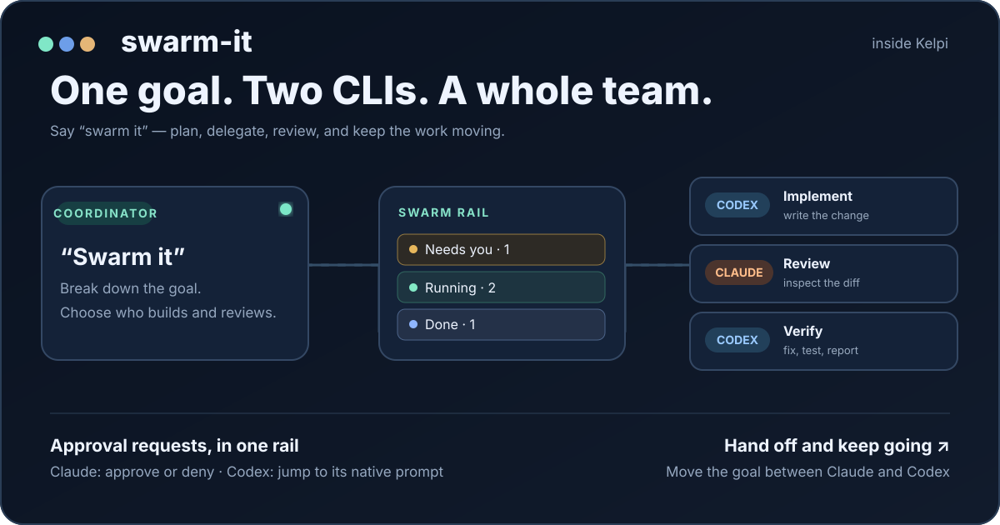
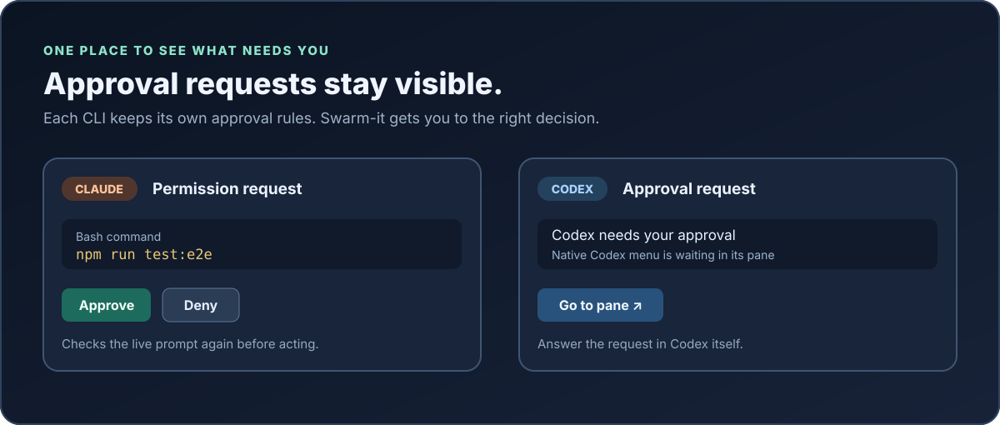
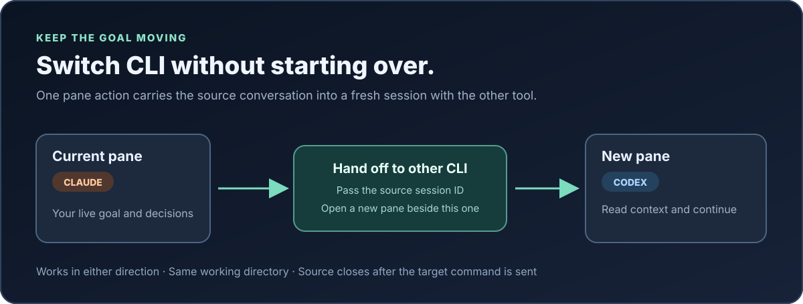

# swarm-it

**Give Claude or Codex a goal. Get a coordinated team in [Kelpi](https://github.com/benfriebe/kelpi).**



Say **“swarm it”** to a Claude Code or Codex coordinator. The skill breaks your goal into tasks, starts workers, waits for results, and can route implementation and review to different CLIs. The Kelpi plugin keeps the work visible in one rail: who is running, who needs you, and what finished.

> The illustrations below explain the workflow. [Earlier Kelpi UI captures](docs/archive/README.md) show the original Claude-only interface.

## What you can do

| Ask for | What happens |
| --- | --- |
| **“Swarm it, all Codex.”** | Codex plans the work and starts Codex workers. |
| **“Swarm it, all Claude.”** | Claude plans the work and starts Claude workers. |
| **“Codex implements; Claude reviews.”** | The coordinator starts review after the implementation diff exists, returns findings to the implementer, and checks the fixes. Reverse the roles whenever you want. |
| **“Use both to review.”** | Separate Claude and Codex reviews can inspect the same change with different focuses. |
| **“Hand this goal to the other CLI.”** | The other CLI opens beside the source with its session ID as context. The pane's **Hand off to other CLI** action works without the skill. |

Each worker gets its own Kelpi pane in a shared **Workers** workspace. Your coordinator stays in place. Completed workers write a short **Goal / Done / Next** result; the rail keeps the result after the worker pane closes.

## One rail for the whole run



The rail shows **Needs you**, **Running**, and **Done**. Claude permission cards include **Approve** and **Deny**; before sending a key, the plugin checks that the live prompt still matches the card. Codex permission cards offer **Go to pane**, where you answer Codex's native prompt. The plugin never sends Claude-style approval keystrokes to Codex.

The timed **Auto** control can approve eligible requests while you are away. It works through Kelpi's permission provider for Claude and through a separate Codex `PermissionRequest` hook for safe Bash requests. Other requests stay with you. Auto has a time limit, an activity log, and [documented safeguards](docs/permissions.md).

## Move between Claude and Codex



Choose **Hand off to other CLI** in a pane's header or pane menu. It opens the other CLI in the same working directory with a plain request: **“Read the Claude session &lt;id&gt; and continue the conversation from where it left off.”** The source transcript path is included when available. The action works in either direction and does not require a skill. The source pane closes after Kelpi sends the target command; a missing session ID leaves it open.

Conversational transfers also pass the source session ID when known. If no ID is available, a short **Goal / Key points / Next** context file can be used instead.

## More than a worker list

- **Reviewable results:** open a worker's Goal / Done / Next result, follow up in its own conversation, or send it back to work.
- **Visible failures:** a worker that stops without a result appears under Needs you with a reason when Kelpi supplies one.
- **Clean workspace:** finished worker panes close after 10 minutes by default; result files remain. Dirty worktrees stay open.
- **Useful pane actions:** run or copy a command Claude suggested, restart Claude after changing hooks, and hand off between CLIs.
- **No hidden permission bypass:** Codex workers use `workspace-write` and `on-request` by default; Claude workers use their configured asking mode.

## Install

You need Kelpi and at least one of Claude Code or Codex CLI. Install the plugin and link the skill into each CLI you want to use:

```sh
git clone https://github.com/abhayachauhan/swarm-it
cd swarm-it
kelpi plugin install . --trust
kelpi install-hooks
ln -s "$PWD/skills/swarm-it" ~/.claude/skills/swarm-it
ln -s "$PWD/skills/swarm-it" ~/.codex/skills/swarm-it
```

Run only the `ln -s` lines for CLIs you have installed. `--trust` allows this local plugin's backend to run with your account's access, so inspect the code before installation. For Codex Auto approval of eligible Bash requests, install and trust the additional hook:

```sh
node skills/swarm-it/install-codex-hook.mjs
```

Then open `/hooks` in Codex to trust the new hook definition. In Kelpi, select Swarm-it as the permission provider if you want timed Auto decisions from Claude:

```sh
kelpi plugin service-select kelpi.agent.permissions local.swarm-view.permissions
```

Start in a Kelpi workspace inside a Group and say **“swarm it.”** Open the rail from Kelpi's **Swarm** status item or with `ctrl+alt+j`.

For setup checks, troubleshooting, and the exact permission boundaries, see [Setup](docs/setup.md) and [Permissions](docs/permissions.md).

## Under the hood

Swarm-it has two parts: the `local.swarm-view` Kelpi plugin for the rail, results, approvals, and pane actions; and the shared [`swarm-it` skill](skills/swarm-it/SKILL.md) for planning and coordination. Worker results live under `~/.kelpi-swarm/results/`. The plugin has no build step or npm dependencies.

```sh
node --test
kelpi plugin validate .
```

[Feature guide](docs/features.md) · [Setup](docs/setup.md) · [Permissions](docs/permissions.md) · [Historical Claude/Codex implementation plan](docs/claude-codex-plan.md)
