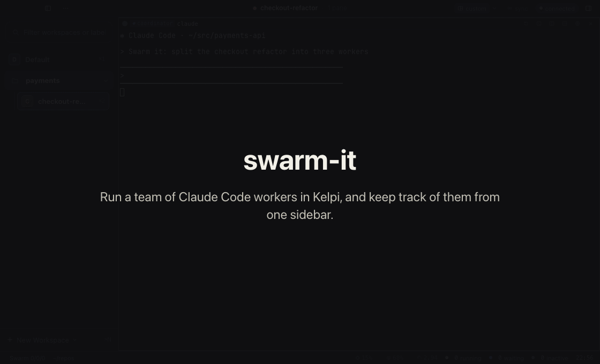
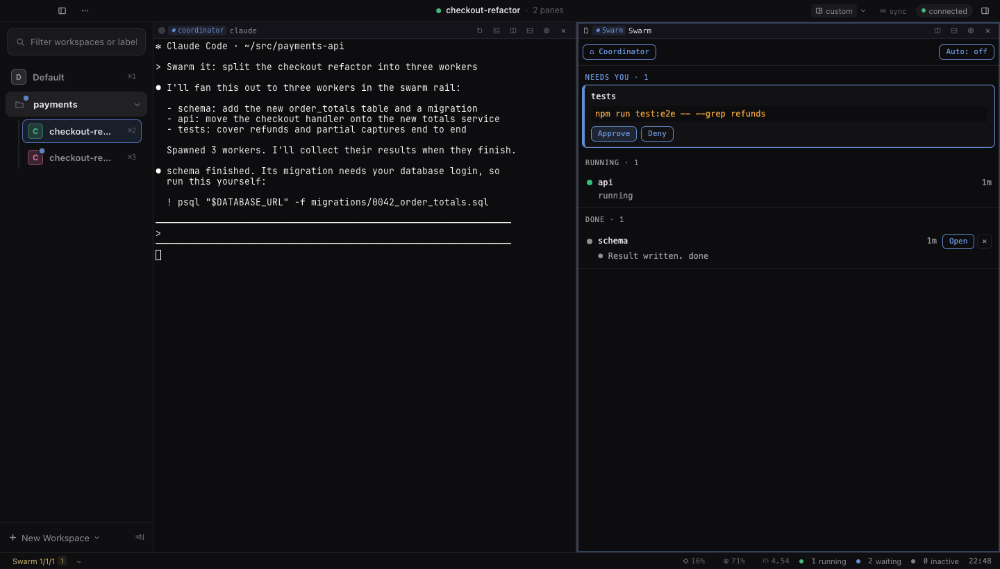
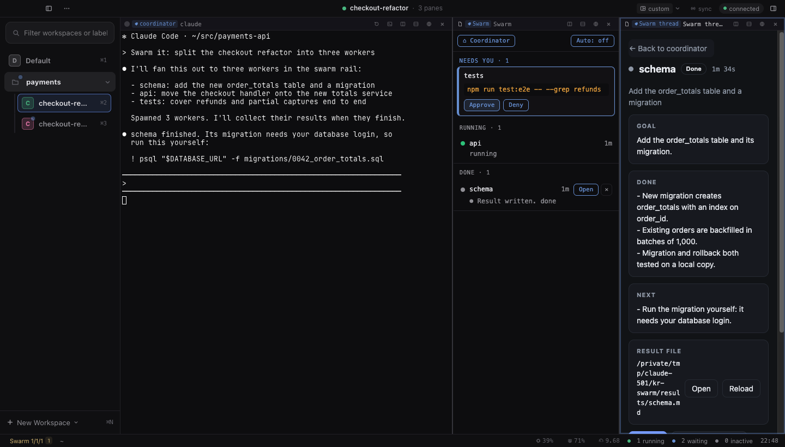
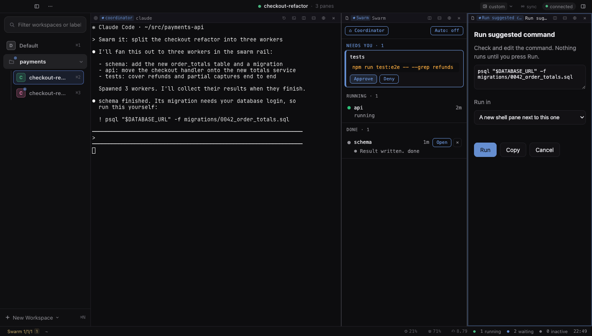

# swarm-it

Run a swarm of Claude Code workers in [Kelpi](https://github.com/benfriebe/kelpi), and keep track of them
from one sidebar.



You ask your coordinator Claude to "swarm it". It splits the work into tasks and starts one headless Claude
per task. Each worker gets its own pane, out of your way. The **Swarm rail** shows what every worker is
doing, raises their permission prompts so you can answer them in one place, and shows each worker's
result when it finishes.

swarm-it is two parts that work together:

- **The Kelpi plugin** (`local.swarm-view`): the rail, the result view and a few pane tools.
- **The `swarm-it` Claude Code skill** (`skills/swarm-it`): how your coordinator Claude starts and waits for workers.

## Features

### Swarm rail



A sidebar list of every worker, grouped by what it needs from you:

- **Needs you**: a worker stopped on a permission prompt. The card shows the exact command. Approve or
  Deny it here without leaving the pane you're working in. Before sending anything, the plugin checks that
  the prompt on screen is still the one you saw.
- **Running**: workers still going, and how long they've taken.
- **Done**: just a count of finished workers ("Done · 12"). They are not listed and need no clearing.
  Their results stay in `~/.kelpi-swarm/results/`.

Every swarm's workers live in one shared `Workers` workspace, inside a collapsed `Workers` Group, so the
sidebar shows one row for all of them and your coordinator keeps its space. Each coordinator's rail still
shows only its own workers. `swarm-spawn` opens each worker straight in `Workers`, so Kelpi never switches
your view while you work elsewhere. The exception is before `Workers` exists: the plugin creates it and
moves that first worker in, and Kelpi switches to it once.

Finished workers clean themselves up: 10 minutes after a worker finishes, its pane is closed and it leaves
the swarm (the result file stays). A worker whose worktree has uncommitted changes is kept and named under
the rail's ⚠. Change the delay with the `autoCleanMinutes` plugin setting; 0 turns it off. Old
`<name> · workers` workspaces from earlier versions are emptied into `Workers` and removed. **⌂ Coordinator** takes you back to it. The status bar shows the waiting / running / finished
counts, and `ctrl+alt+j` gives the rail the keyboard.

### Worker results



Every worker writes a short result with three headings: **Goal**, **Done** and **Next**. The result view
shows them as cards, with buttons to open or reload the file. Send a follow-up from the same view: a
finished worker picks up its own conversation again with your message.

### Workers that stop without a result

On Kelpi 0.2.18 or newer the plugin listens to Claude's hook events (`api.agents.onEvent`). A worker's last
line in the rail is then the last line of Claude's final reply, not a screen read. If a worker's Claude ends
with no result file, the worker shows under **Needs you** as "`<label>` stopped: `<reason>`", for example
"usage limit reached", "rate limit reached" or "stopped with an error: ...", with a **Go to pane** button.
On older Kelpi nothing changes: the rail reads the screen and shows no stopped row.

`swarm-wait` also ends for such a worker and prints `FAILED <pane>:<label> <reason>`. The plugin tells it through
a small file, `~/.kelpi-swarm/exits/<pane-id>.json` (`{ paneID, label, reason, at }`; under the `manifestDir`
setting, or `$SWARM_MANIFEST_DIR` for `swarm-wait`, when that is set). The file goes away when Claude starts
again in that pane. Workers with no result path are never marked stopped.

### Auto-approve

For an unattended run, the rail's **Auto** button approves permission prompts for a set time: 10 minutes,
4 hours, 12 hours, or until 9am. It covers every Claude pane, not only swarm workers.

- It's off after every install or reload, and never turns on by itself.
- **Through Kelpi (Kelpi 0.2.18 or later).** swarm-it is a `kelpi.agent.permissions` provider: Claude's
  own permission request reaches the plugin with the real command, so nothing is read off the screen.
  Select it once, then restart Claude sessions that started before (**Restart Claude** in the pane menu),
  because Claude loads hooks when it starts:

  ```sh
  kelpi plugin service-select kelpi.agent.permissions local.swarm-view.permissions
  kelpi install-hooks
  ```

  While Auto is off, and for anything it does not approve, the plugin abstains: Claude shows its normal
  prompt and the rail's Approve and Deny work as before. `kelpi plugin service-select kelpi.agent.permissions default`
  undoes the selection.
- **Screen fallback.** Until swarm-it is the selected provider, or on an older Kelpi, Auto reads prompts off
  the screen and presses Enter as before, and while it is on the rail's ⚠ and the status bar tooltip say how
  to fix that. Once the provider is active the screen path never presses Enter, so no prompt is answered twice.
  Prompts already showing when you turn Auto on then wait for you, and a prompt from a session Kelpi never asked
  about is logged as `NOT_ASKED`.
- Some commands are never auto-approved: for example `sudo`, `git reset --hard`, `kubectl delete`,
  `terraform apply`, writes to AWS, and anything piped into a shell. Those stay on the rail for you.
  Through Kelpi the list also takes in every rule of Kelpi's own auto-approve example, and leaves a command
  over several lines or over 4 KiB, and a Bash call that asks to run outside Claude's sandbox. A few harmless
  commands wait for you as a result, such as `find . -name "*.ts"`, `node --test test/*.mjs` and
  `git restore --source HEAD x`. The screen fallback applies both lists too.
- File reads, edits and writes, web fetches and read-only MCP tools are approved as before; any other tool waits
  for you. An MCP tool is answered only when its name says it reads (`get_issue`, `slack_read_channel`,
  `notion-search`) and no word in it says it changes something (`write_file`, `sendMessage`, `cancel_build`);
  every other MCP tool waits for you. Kelpi's list also reads every string of an MCP call. A write path holding
  `.` or `..` waits for you, since `..` after a symlink climbs from the link's target.
  Through Kelpi, a write to Claude's or Codex's settings, `.claude` folders or `.mcp.json`, git hooks or config,
  a shell startup file or a launch agent waits for you (symlinks are followed first, and a file with a second
  name through a hard link waits too), and so does any input
  holding a control character, a path that isn't absolute, or one it can't follow within half a second. These
  checks catch mistakes, not an agent set on getting round them: writing a script and then running it is not
  caught, as in Kelpi's own example, and neither is a folder swapped for a symlink after the write was approved.
- A pane where Claude has exited is never answered, even if an old prompt is still on its screen.
- Every approval and refusal goes in a log (**Swarm: list or clear the auto-approve log** in the palette).
  Each entry's `source` says whether it came through Kelpi (`provider`) or the screen (`screen`). Nothing is
  logged while Auto is off.
- **Headless workers.** Kelpi asks the provider for `claude -p` workers too. Claude Code's hooks reference
  says that in sessions that can't show a prompt it "still runs these hooks, and if no hook returns a
  decision, it denies the tool call"; Kelpi's `docs/plugin-services.md` (Agent permission decisions) says the
  same, and `kelpi event permission-request` only needs the pane id every Kelpi pane sets. So a worker's
  request that swarm-it leaves is denied, not shown as a prompt. This has not been tried live yet.

### Run last suggested command



When Claude asks you to run a command yourself (a line starting `! `, a code block, or a command in its
reply), press `cmd+shift+u` or the pane header button. The plugin finds the last suggestion, rejoins it
where the terminal wrapped it, and shows it in an editable box. Nothing runs until you press **Run**. It can
run in a new shell pane beside Claude, or in another shell pane in the same workspace. A one-line
command defaults to Claude's own pane, so its output lands in the conversation, unless Claude is mid-reply
or showing a permission prompt. Background shells or agents still running after Claude's reply do not count
as mid-reply. **Copy** puts the
fixed command on the clipboard instead.

### Restart Claude

**Restart Claude (quit and resume)** in the pane header or the pane menu quits Claude in that pane and starts
it again on the same conversation. Useful after changing settings, hooks or MCP servers.

## Install

You need Kelpi, Claude Code, and Kelpi's Claude Code hooks (`kelpi install-hooks`).

1. Install the plugin:

   ```sh
   git clone https://github.com/abhayachauhan/swarm-it
   cd swarm-it
   kelpi plugin install . --trust
   ```

   `--trust` lets the plugin's backend run with full access to your machine, so read the code first. To
   share a single file instead, run `kelpi plugin pack . --out swarm-view.kelpi-plugin` and install that.

2. Link the skill into Claude Code:

   ```sh
   ln -s "$PWD/skills/swarm-it" ~/.claude/skills/swarm-it
   ```

3. In a Kelpi workspace that sits inside a Group, ask Claude to "swarm it". Open the rail from the
   status bar's **Swarm** counter or with `ctrl+alt+j`.

## How it works

- `skills/swarm-it/swarm-spawn` splits a pane, adds it to the swarm manifest (`~/.kelpi-swarm/<workspace>.json`),
  and starts `claude -p` on a task file. `swarm-wait` waits until every result file exists, a pane closes, or a worker's Claude ends with no result.
- Each worker's manifest entry also records `taskPath`, `model`, `mode`, `dir` and `startedAt`. `swarm-retry
  <pane-id>:<label>` uses them to start a dead worker again. `swarm-spawn` first prunes dead workers and dead
  swarms' manifests (`manifest-writer prune`), and moves the old result of a reused label to
  `results/archive/`. Result files are never deleted.
- Results live in `~/.kelpi-swarm/results/`. The rail refuses to read files outside that folder or a worker's
  trusted worktree.
- The plugin reads worker screens to spot Claude's permission prompts. Approving sends a single Enter, and
  only after a fresh capture confirms the prompt hasn't changed. With swarm-it selected as Kelpi's permissions
  provider, auto-approve answers Claude's permission requests directly instead.

Plugin settings (`kelpi plugin settings local.swarm-view`): hide workers in the swarm workspace, default snooze,
coordinator label, manifest folder, and the folders worker worktrees must live in.

## Development

No build step and no npm dependencies.

```sh
node --test               # unit tests, no Kelpi needed
kelpi plugin validate .   # check the manifest offline
```

`scenarios/` holds integration scenarios that run against a private Kelpi instance through `bin/k`, which
refuses to talk to anything but a loopback socket. `contracts/` documents every command and the manifest
format.

## License

[MIT](LICENSE)
